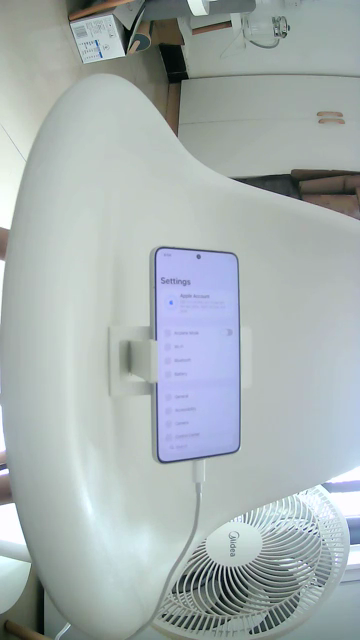

# K80 iOS26：短长按273进入Settings，菜单尚未复现

273完成一次无人值守临时启动，零重试，332.7633秒自动回核验TWRP，7组保护采样一致，BCB尾部保留／完整页读回通过。接收器正常退出0，30普通＋1UI273＋7ROI共83270字节；340秒无音频H264相机成功。[实际证据](evidence/k80-gpu-v273-menu-attempt-observed-2026-11-17.json)。

机主指出历史Settings长按会弹出带Liquid Glass背景的菜单，可能触发卡死。此假设继续保留。271约2405ms长按最终进入编辑态；273将按住缩短为两次400ms报告后抬起，实际802ms，**结果打开Settings应用主页，尚未确认菜单阶段**。不得把此次应用打开或271编辑态当作Liquid Glass正确性的验收。

## 本次实际构建与保护

kernel `d87f08e6fb07db607d4dfdb6dca783c984030c75759440264e63d76fc3df5155`；boot `6201bdc8c1cdfb87e75ff833b5f362df0d0489f7e464639e8acb53d69c903837`；boot ID `04f3917d99e64051884158a2a802bc9d`。33原生对象、1399输入完整链接0undefined，144关键依赖、CPU16KiB／GPU4KiB／磁盘4KiB边界及当前受影响sanitizer检查通过。[源码补丁及来源](../patches/gpu/ios26-glass-menu273/source-manifest.json)。

实际271根 `c60b198ded30a982cf96ee9cb66211a8f74c7d8fa80f5b6dd8e0839e121304fc`原样只读复用，ADT `c089535db85a5998f1da010663b7384a921c7417c48af224fa0dc6d94113d1f3`、FD `1bf94507996700b508474956f5d7f96fa7df764201951b0ce8e5ce8b592a11ab`及启动器保持。独立FAT仅替换内核，无根安装、固件构建、存储布局变化、bootstrap、刷机或恢复重试。保持原1022字节参数、300秒独立硬件WDT、600秒自动回收。Android／Data／17／GPT／Recovery／slot／启动分区保护采样保持。

源代码父候选为272；272的Done场景仅保留离线内核，没有打包或启动。273打包来源和上次真实硬件基线是271，不能混写两者。

## 菜单前后与图像

真实Virtual HID上滑17次及抬起返回0，dispatch1288ms；30秒间隔后Settings坐标(28330,3938)按住两次／400ms及抬起返回0，dispatch802ms。这些是调用持续时间，不是用户界面响应延迟，也没有逐事件队列ACK。

实际内核uptime202053ms的按住前快照：frame257／SID290／producer=completed=access260；204856ms的抬起后2秒快照：frame259／SID295／producer=completed=access263。两份CF无后端错误／丢失，实际应用调用3817→3899。证明该窗口内呈现与fence推进，不能由此证明菜单已经显示或后续稳定。场景时旧compact observer dropped1，末普通样本dropped2，均保留；不能把CPU诊断try-lock丢失直接当作GPU失败。

272公共CPU输入门槛修复只移除旧compact dropped的GPU失败判定，继续显式报告丢失。初始GPU任务、真实task身份、正常live native客户端、245 GPU来源access fence、完成ledger／acquire／copy及权威CF失败／丢失门槛保持。该门槛没有DMA停止／复位／释放权限。[272补丁](../patches/gpu/ios26-edit-done272/source-manifest.json)。

场景结束5秒后截取的串口ROI来自frame260／SID296／producer=completed=access264，payload SHA `7d4b218b2f550939e019dbc7bff0486aa69f98e3cc162513b08125fece4f1643`。画面接近浅色空白、小角标，实际相机204–206秒也为浅色应用过渡；208／210／240／270／300秒已显示Settings列表，不能误写成持续白屏。未用图像生成、补画或增强还原内容。

相机140秒锁屏、180–203秒桌面，330秒可见蓝色Recovery头部及键盘。相机比fastboot返回晚11.5525秒开始，录像秒数不能直接作为内核uptime。所检查画面未确立context menu；不能排除未采样的短暂过渡。没有在列表出现后继续输入，故静态列表不能证明后续交互或没有卡死。

## 日志、来源与下一步

初始GPU已知任务实际fence2／CRCe843b26a／ring101:101／引用0／table2:2／OOB127通过。backboardd日志9621字节全部已发布／收到，CRC完整，pending0／gaps0；daemon仍存活，退出不是本轮要求。CF两个客户端ID64 CloseReturn16/raw0、129 live4196调用，无CF后端错误或丢失；方法8 Unsupported为能力拒绝。VM成功map744／unmap331、累计字节4403625984／3722166272，只是累计完成量，不能证明无泄漏或live内存用量。30普通记录上限限制后续时间窗，不能由最后fence推断之后一直停止。

实际根中的frontend SHA `f7abe4e2584eea1f572a3db69e24ab02024f4c7e92fe9d641aee933f7f420494`及Turnip SHA `0ff53258845fa6eea197e0b94a05a856fc7dc39de589a50474eb64bf584404ba`匹配226编译收据；Rust archive `79ab4b6b7adbe475fe7f6eea33b98d883a6c6d43c929f63e61f89d25de594349`匹配214实际链接输入。Cargo清单指向本地runtime；附件读取、shadow计划及degradation源码与选定上游624bab3918de5b978e1101517abca2b4fa426565对应文件逐字节一致。保留记录的source content ID与runtime ID，不把32位内容ID冒称Git提交，也不声称重新重建了整树历史source ID。

已有副本／快照后端可复用；源码仍明确记录heap／argument-buffer、storage、depth/stencil、buffer alias及未服务shadow等剩余路径。当前render-pass split、memoryless backing、attachment-read-in-place警告不是菜单特异性或卡死根因证据。本轮没有修改frontend／Rust／Turnip，也没有反汇编、逆向、地址符号化或检查Apple shader二进制。

下一候选在实际800ms应用打开和2405ms编辑态之间调整有界hold，并保留更晚的实际呈现截图；先确认菜单复现，再定位Liquid Glass相关后端。完整Metal桌面／生命周期／跨task／物理FT3683验收未完成，未比较CPU与GPU帧率。只暂存，不额外commit或push。
