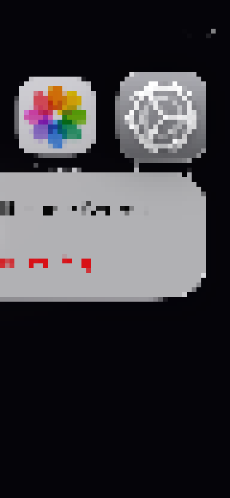

# K80 iOS26：已捕获Settings长按菜单274

274用实际1604ms按住／松手复现了桌面Settings长按菜单。串口ROI及相机205–300秒均看到图标下方的浅色圆角菜单，串口还能辨认黑色文字／红色操作项。菜单静态显示不能证明后续仍可交互，也不能证明Liquid Glass的透明、模糊和光学效果正确；历史卡死根因仍未确定。[完整实机证据](evidence/k80-gpu-v274-context-menu-observed-2026-11-17.json)。

一次无人值守临时启动、零重试，332.7768秒自动回核验TWRP；7组保护采样一致，BCB尾部保留／完整页读回通过。接收器exit0，30普通＋1UI274＋7ROI共83293字节。340秒无音频H264相机9372566字节，SHA `99beec53d506d5d40d2c3c57a5a43ac010d33c5a55fbb03b7d399bc796561088`；相机比fastboot返回晚5.2876秒开始，330秒画面为TeamWin splash，实际Recovery另外经ADB核验。

## 精确输入与修改

kernel `bd8e8eec1fed57f33520c66bf0b5c6ec604622f752c9812838a35c3dd4103e2d`；boot `790b9300b1a663c4012115dd308563cb67e3c454b0fa7b8130413b1c15a26e43`；boot ID `535c8767941e4a5aa5c5995b6578ff51`。33原生对象、1399完整链接输入0undefined，144关键依赖、CPU16KiB／GPU4KiB／磁盘4KiB及当前受影响检查通过。[源码／逐文件来源／零fuzz重放](../patches/gpu/ios26-menu-midhold274/source-manifest.json)。

继续只读复用实际271根 `c60b198ded30a982cf96ee9cb66211a8f74c7d8fa80f5b6dd8e0839e121304fc`，ADT `c089535db85a5998f1da010663b7384a921c7417c48af224fa0dc6d94113d1f3`、FD `1bf94507996700b508474956f5d7f96fa7df764201951b0ce8e5ce8b592a11ab`及启动器保持。无新增根写入、固件构建、布局变化、bootstrap、刷机、恢复重试或物理协助。Android／Data／17／GPT／Recovery／slot／启动分区保护保持。

相对273，只将候选hold改为4次400ms报告后抬起，并将截图延后到场景结束20秒；新建274线协议和精确boot身份，CPU快照采集及真实GPU／VM／时钟／提交／fence／关闭后端保持。没有针对Settings或shader名字改写渲染语义。实际800ms场景273打开应用，2405ms场景271进入编辑态，均保留；1600ms只是本次成功复现时序，不是通用识别阈值。

## 实机记录及边界

17次合成上滑及抬起返回0，dispatch1285ms；Settings坐标仍来自实际270图像(28330,3938)，4次held报告及抬起返回0，dispatch1604ms。没有逐事件队列ACK，不把dispatch持续时间当UI响应延迟，也不把Virtual HID当作FT3683物理手势验收。

实际按住前uptime202074ms：frame307／SID340／producer=completed=access310；抬起后2秒uptime205679ms：frame311／SID344／producer=completed=access314，应用调用4211→4344。两次CF无后端错误／丢失，compact dropped0。真实20秒延后ROI：frame314／SID347／producer=completed=access317，payload SHA `dbe5a66a58ba1214afdf9c5d3d012ad0d19a14a2390fdb7b35767fda97780c44`。菜单图像与已完成GPU来源记录关联，但没有已知参考像素CRC，局部采样不等于全屏／scanout验收。

初始GPU已知任务fence2／CRCe843b26a／ring101:101／引用0／table2:2／OOB127通过。backboardd日志9621字节全部发布／收到，CRC完整，pending0／gaps0；daemon存活，不要求probe退出／4关闭。两个CF客户端均被观察：ID64 CloseReturn16/raw0，129仍live4481调用，末CF flags1表示registered且没有active Scope；flags3才含Scope，不能倒置后推断BoFree卡死。旧compact observer末4484调用、dropped0。方法8 Unsupported仍为能力拒绝。VM成功map753／unmap379，累计4900667392／4304666624字节，不是live用量或无泄漏证明。

30普通记录上限限制更晚的时间窗。相机菜单持续不变可能只是没有后续输入，不能单凭静态图像诊断死锁，也不能据本次没有采样到后端错误就排除历史Liquid Glass故障。render-pass split、memoryless backing、attachment-read-in-place警告继续保留，当前不归为菜单特异根因。273已经核对当前实际插件／Rust archive／编译清单／相关上游源码链，本轮未替换frontend／Rust／Turnip。

ASan／UBSan／TSan覆盖真实plan、worker、collector、门槛、串口入口及相关生命周期；实际receiver.main至JSON、旧schema／截断／CRC／外来启动ID拒绝、92个完整bundle拒绝及相机边界通过。最初离线review因遗漏复制既有reference receipt而失败，失败脚本保留；补齐同字节receipt后按实际依赖重查通过，不涉及驱动修改或设备重试。所有软件结果均不代替硬件功能验收。

下一步沿用已复现菜单时序，加入一次有界的菜单外点按及其后真实fence／CF／呈现图像，验证菜单能否收起。然后再推进应用继续响应与相关生命周期；完整Metal桌面、跨task、物理FT3683点按／滑动／抬起／身份／边缘及稳定性尚未验收。当前手机已安全回Recovery、所有活动scope清空。无反汇编、逆向、地址符号化或Apple shader二进制检查；只暂存，不新增commit／push。

## 275离线构建时的空间整理

275首次原生编译在保存命令收据时遇到ENOSPC，零字节收据／已生成对象和日志保存在独立失败目录；当时没有275手机启动。为保留历史原始字节，先核验旧boot容器内完整FAT／内核SHA，再对269未准入pre-readiness的重复归档及262–265已被替代的FAT副本进行容器去重；原始201326592字节FAT均可从各自未改动的boot镜像恢复。272未启动候选内核改为gzip保存，并完整解压复核长度／SHA。每项本地收据保留原路径、哈希、偏移／长度／模式及恢复方法；需要重验历史完整bundle时先恢复相应原路径。源码、对象、根镜像、当前273／274／275 FAT、17 GPU及真机原始日志／图像保持。空间恢复后重新完成275的33原生对象、1399输入、145依赖及当前测试，不把失败输出当通过或旧测试当新测试。
