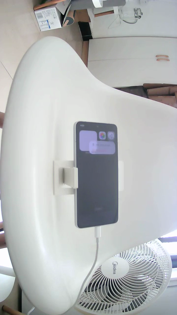
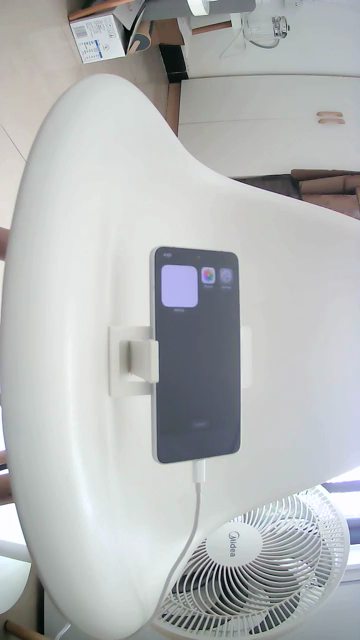

# K80 iOS26：菜单显示后可收起275

275完成了一次“Settings长按菜单出现→菜单外点按→菜单收起”的真实响应。相机204／206／208秒可见圆角菜单，210秒后恢复桌面；串口保存了菜单收起后的图标图像。完成fence按三个实际CPU快照292→296→299推进，延后ROI来源fence302，对应CF没有后端错误／丢失。当前证据支持这一次有界的菜单后响应，历史卡死根因、全部Liquid Glass光学效果及长期稳定性仍未确定。[完整实机证据](evidence/k80-gpu-v275-menu-dismiss-observed-2026-11-17.json)。

## 精确构建与保护

kernel `5b7668c30fba30e2f444a15153b4c4389e9c8243adfa87ec70ee838e0c9ac93b`；boot `716f24c17f6a6cb69ef4817ba5a855ab5395825bbdf997b79fb6ff7f69663e1c`；boot ID `3bdbf713eb0f47c28de0e5f0539836d9`。33原生对象、1399完整链接输入0undefined，145关键依赖、CPU16KiB／GPU4KiB／磁盘4KiB检查通过。[完整来源与零fuzz补丁重放](../patches/gpu/ios26-menu-dismiss275/source-manifest.json)。

实际271根 `c60b198ded30a982cf96ee9cb66211a8f74c7d8fa80f5b6dd8e0839e121304fc`继续只读复用。FD `1bf94507996700b508474956f5d7f96fa7df764201951b0ce8e5ce8b592a11ab`、ADT `c089535db85a5998f1da010663b7384a921c7417c48af224fa0dc6d94113d1f3`和启动器保持，无新根安装或布局变化。仍为核验TWRP起点、新scope／owner／ready／claim、接收器先行、300秒独立WDT／600秒自动回收、一次临时启动、零重试。实际332.7782秒回核验TWRP，7组保护采样一致，BCB尾部保留／完整页读回通过；所有活动scope已清空。Android／Data／17／GPT／Recovery／slot／启动分区保护保持，无bootstrap、刷机恢复或物理协助。

## 实际修改与验证

[Tap275](../native/ios26-ui275/ZornUiTap275.h)参数化复用272已有点按／抬起路径，先核对配置，再按真实CPU就绪条件等待8秒，执行100ms接触和强制抬起，10秒预算。坐标(16384,24576)来自实际274相机中菜单下方的空白区域，没有选择菜单项。已有274菜单计划及CPU进度采集后端原样复用。源码patch接通真实HID service、三个CPU快照、新96word／416字节UI记录和5秒延后呈现截图；没有修改GPU／VM／时钟／提交／fence／关闭后端或frontend／Rust／Turnip。

实际上滑17次及抬起返回0，dispatch1286ms；Settings按住4×400ms及抬起返回0，dispatch1604ms；菜单外点按及抬起返回0，dispatch101ms。以上是调用持续时间，不是逐事件队列ACK或UI响应延迟。

三个快照分别为：

- 菜单前uptime202087ms：frame289／SID322／producer=completed=access292，应用调用4034。
- 菜单后2秒uptime205692ms：frame293／SID326／producer=completed=access296，应用调用4155。
- 点按后2秒uptime215795ms：frame296／SID329／producer=completed=access299，应用调用4343。

全部availability7、CF后端sequence0／dropped0、compact dropped0。三类CPU采集分别返回，不声称它们构成同一原子的GPU瞬间快照。新UI记录的0–31为菜单结果，32–47为菜单前CPU记录，48–63为菜单后记录，64–79为菜单外点按结果／配置／时间，80–95为点按后记录；CRC覆盖408字节，schema275位于412。旧schema、截断、CRC及新tap字段拒绝检查通过；不伪造旧UI包给旧解码器解释。

延后实际ROI来自frame299／SID332／producer=completed=access302，payload SHA `63d1061043f7920dc8562b7f822bf251496368e2ab9c3c28c0e115d80ee9ae6d`，可见Photos／Settings和空白区域，菜单已消失。它关联已完成GPU来源，但没有已知参考CRC，不能代替全屏／scanout或所有Glass效果验收。

原生初始已知任务fence2／CRCe843b26a／ring101:101／引用0／table2:2／OOB127通过。接收器exit0，30普通＋1UI275＋7ROI共83440字节；9621字节backboardd日志全部发布／收到，CRC完整，pending0／gaps0。daemon仍live，不要求probe退出或4关闭。末普通CF观察ID64 CloseReturn16/raw0、129 live4304调用，CF无后端错误／丢失，compact末4307调用／dropped0。普通记录先于更晚UI及ROI，不能把较小的早期计数当成倒退。flags1是registered无Scope，flags3含active Scope；能力拒绝不当作后端错误。

VM末普通样本map730／unmap360，累计4649779200／4046045184字节，不是live内存用量或无泄漏证明。93准入拒绝、真实receiver.main到最终JSON、三快照／416字节／14解码拒绝／7截断、失败tap与菜单／ROI独立分级及相关ASan／UBSan／TSan通过。不能把这些软件结果代替实机验收。

340秒H264视频10123844字节，SHA `e3025d815aad0aaa9c7f420b0dab6c61c47a91b088b8bdd9b6e3e3e1d94cc938`。相机入口的fastboot绑定采样age为0.0431秒，发生于ffmpeg／AVFoundation初始化之前，**不是首帧曝光时间**。所有视频秒数均是clip时间，不与kernel uptime直接对齐；273／274记录的11.5525／5.2876秒age也按此语义解释。330秒为红色Recovery过渡文字，实际TWRP由回收身份检查另证。未生成、补画或增强图像内容。

## 结论与继续工作

实际274已捕获菜单；275在同一精确构建内又捕获了菜单出现和收起，证明这一次操作之后仍有响应。仍需验证随后Settings应用打开／列表滑动、客户端与资源生命周期、跨task隔离和完整物理FT3683输入。旧历史卡死不能仅凭本次结果归因或宣称修好；render-pass split、memoryless backing、attachment-read-in-place日志继续作为线索，未改成恒定成功或删除警示。没有CPU／GPU帧率比较或性能验收。

275首次编译ENOSPC的原始输出保留；空间整理与可恢复原始字节记录见[274交接的空间整理说明](handoff-2026-11-17-k80-ios26-gpu-v274-context-menu.md)。恢复空间后重新构建／验证，新产物不借用失败或旧通过。全部原始硬件证据、源码、对象、根和17 GPU保持。完整目标未完成；只暂存，不新增commit／push。全程无反汇编、逆向、地址符号化或Apple shader二进制检查。
